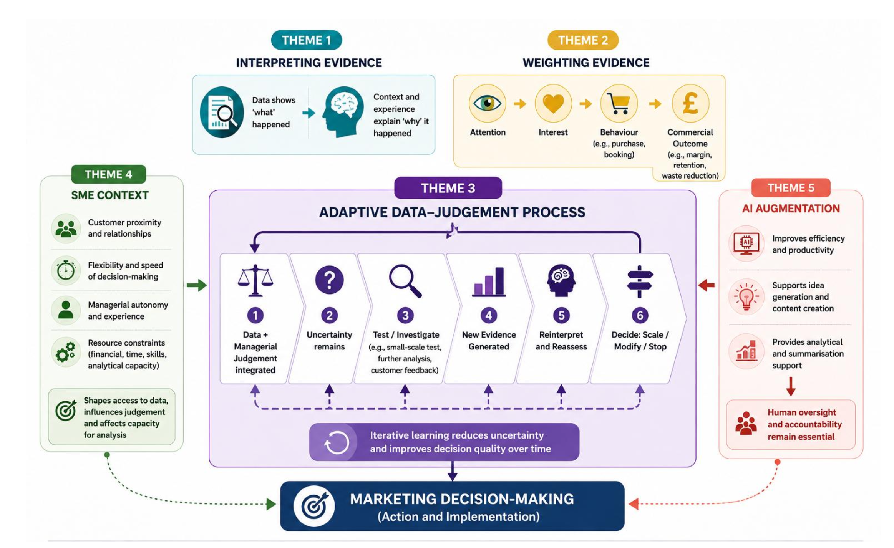
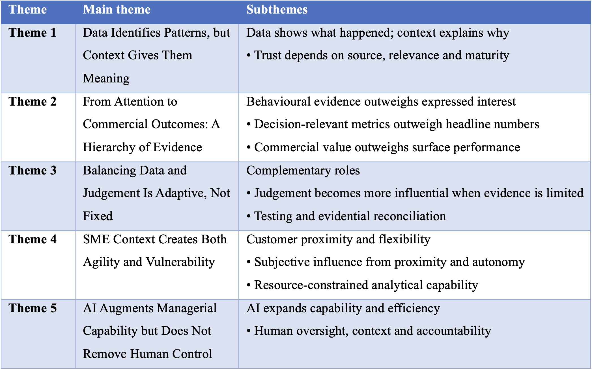

# Data-Driven Decision-Making and Managerial Judgement in UK Retail SMEs

**MSc Business Analytics Dissertation | Qualitative Research | NVivo | Thematic Analysis**

## Research overview

This MSc dissertation investigates **how managers in UK retail small and medium-sized enterprises (SMEs) balance data-driven evidence with managerial judgement when making marketing decisions**.

Many businesses can access sales reports, customer insights, dashboards and AI-supported tools. However, the ability to interpret those signals and decide what to do remains dependent on evidence quality, practical experience and business context. This research examines that interaction from managers' perspectives.

## Research question

> How do managers in UK retail SMEs balance data-driven evidence with managerial judgement in marketing decision-making?

[Research objectives](research/research_objectives.md)

## Study at a glance

| Element | Approach |
|---|---|
| Research design | Interpretivist, inductive, qualitative |
| Data collection | Nine semi-structured interviews |
| Participants | Seven core retail SME cases; two comparative service / wealth-management contexts |
| Data analysis | Braun and Clarke's six-phase thematic analysis |
| Tool | NVivo, used to manage cases, codes and cross-case comparison |
| Main outputs | Five themes and a refined conceptual framework |

## Visual summary

### Conceptual framework

### Thematic framework

Images summarise the study's conceptual/thematic findings; they do not disclose the underlying participant transcripts.

## Five themes identified

1. **Data identifies patterns, but context gives them meaning.**
2. **From attention to commercial outcomes: a hierarchy of evidence.**
3. **Balancing data and judgement is adaptive, not fixed.**
4. **SME context creates both agility and vulnerability.**
5. **AI augments managerial capability but does not remove human control.**

Read the [findings summary](research/findings_summary.md).

## Business and analytics relevance

This research highlights the nontechnical side of business analytics: stakeholder interviewing, requirements discovery, interpretation, evidence assessment, decision-making under uncertainty, resource-aware recommendations and responsible AI adoption.

**Practical takeaway:** Managers benefit from prioritising decision-relevant measures, investigating what explains a metric, testing uncertain decisions and retaining human accountability for AI-assisted recommendations.

## Repository structure

- [`images/`](images/) — non-identifying visual frameworks.
- [`research/research_objectives.md`](research/research_objectives.md) — research aim, question and objectives.
- [`research/methodology.md`](research/methodology.md) — sampling, interviews, NVivo, thematic analysis and ethics.
- [`research/findings_summary.md`](research/findings_summary.md) — themes, interpretation, practical implications and limitations.

## Ethics, confidentiality and access

**No raw interview transcripts, audio, consent records, identifying business information or personal data are published.** Research participants supplied data for a specific approved research purpose, not automatically for public redistribution.

This repository is a **public research-summary portfolio**, not a public release of primary interview data or an executable software package. Any additional publication must remain consistent with participant permissions and university research/data policies.

## Limitations

Nine purposively selected, self-report interviews provide contextual insight, not statistically generalisable estimates. The design is cross-sectional and includes two comparative cases outside core retail SMEs. The qualitative themes describe how participants understood their decisions; they do not quantify company performance improvements.
